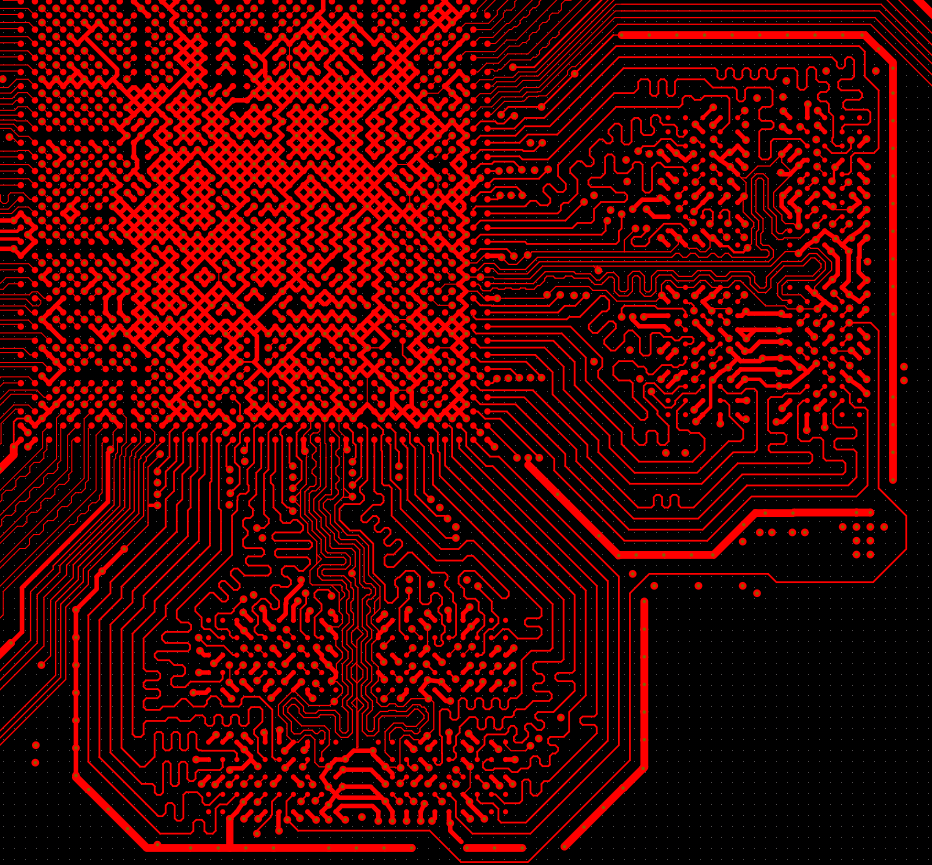
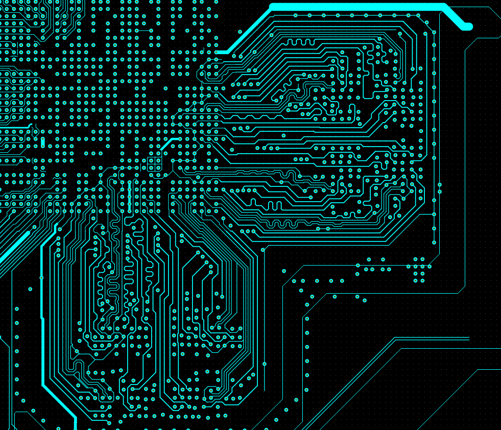
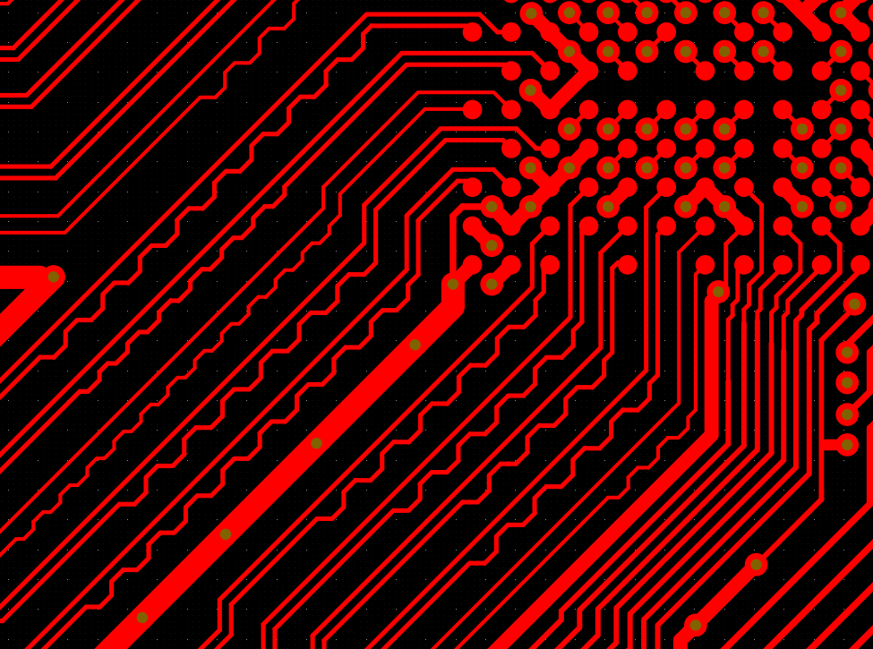
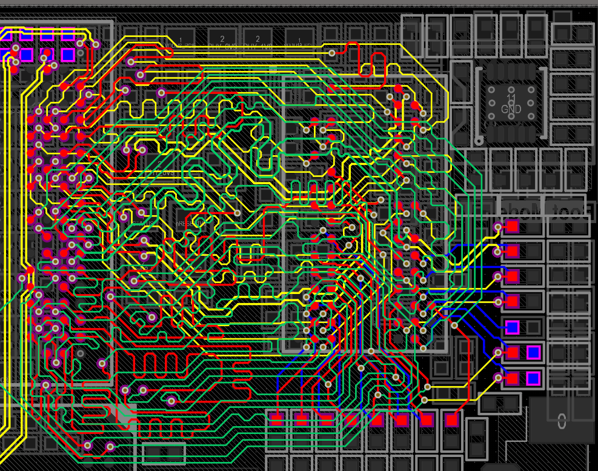
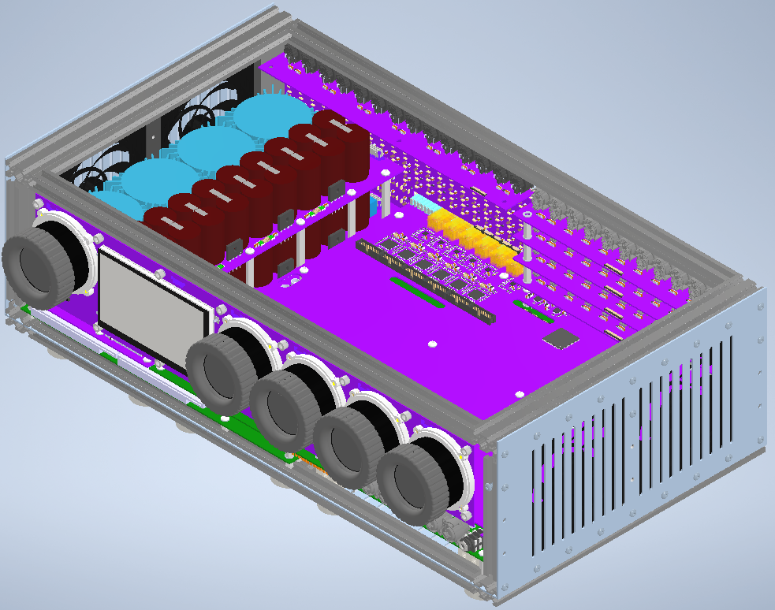
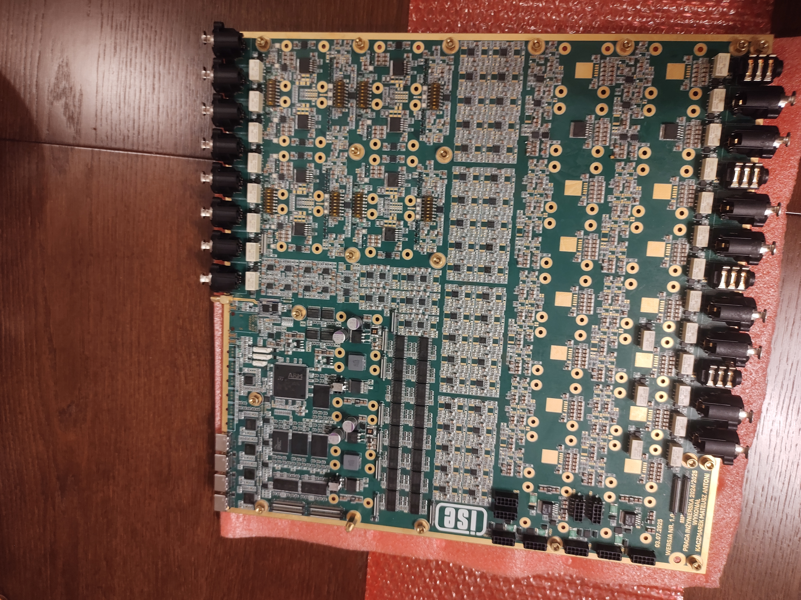
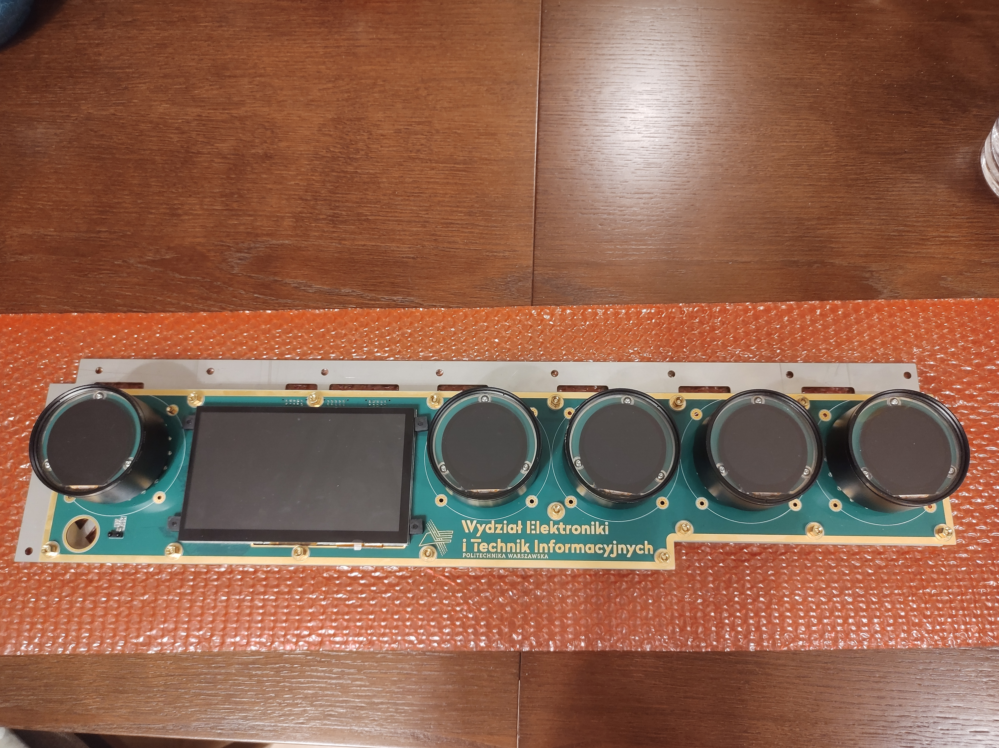

# Portfolio Projektowe / Engineering Portfolio
*Mateusz Kaczmarek - Hardware / PCB Engineer*

[🇬🇧 Switch to English Version](#english-version)

Witaj w moim repozytorium! Znajdziesz tutaj kompleksowe portfolio moich projektów inżynierskich i akademickich, obejmujących pełen cykl projektowania produktu – od koncepcji i schematów, przez symulacje, projektowanie obwodów drukowanych (PCB), integrację mechaniczną 3D, aż po finalny montaż i uruchomienie sprzętu (hardware bring-up).

Głównym obszarem moich zainteresowań i specjalizacji jest projektowanie zaawansowanych obwodów drukowanych (High-Speed PCB), układów analogowych, cyfrowych i mieszanych (Mixed-Signal), energoelektroniki (Power Electronics) oraz systemów wbudowanych opartych na architekturze FPGA i układach SoC.

---

### 📸 Wybrane Projekty (Preview)

Poniżej znajduje się krótki zwiastun moich możliwości projektowych. **Z uwagi na ochronę własności intelektualnej (IP), pełna dokumentacja, schematy blokowe oraz pomiary laboratoryjne znajdują się wyłącznie w załączonych plikach PDF.**

**1. Uniwersalny Modułowy System Pomiarowy (Moduł SoM Rockchip RK3588)**
Sercem układu obliczeniowego jest autorski moduł bazujący na procesorze Rockchip RK3588, realizowany na 8-warstwowym obwodzie drukowanym z rygorystyczną kontrolą impedancji.

> *High-Speed Routing: Precyzyjne wyprowadzenie magistrali szybkiej pamięci LPDDR4 z układu BGA na warstwie wierzchniej (Top).*
> 

> *High-Speed Routing: Kontynuacja prowadzenia magistrali LPDDR4 na wewnętrznej warstwie sygnałowej (L6).*
> 

> *Signal Integrity: Meandrowanie i wyrównywanie długości ścieżek (Length-Tuning) dla różnicowej magistrali PCIe.*
> 

**2. Uniwersalny Modułowy System Pomiarowy (Karta Rozszerzeń Ethernet TSN)**
Karta zapewniająca deterministyczną komunikację sieciową (IEEE 1588v2), zrealizowana na 6-warstwowym stosie z zaawansowanym switchem LAN9696.

> *High-Speed Routing: Gęsty routing magistrali szybkiej pamięci DDR widoczny w przekroju wszystkich warstw sygnałowych obwodu drukowanego.*
> 

**3. Zaawansowany System Audio-Wizualny (Mixed-Signal & HMI)**
Projekt łączący precyzyjne, niskoszumne tory audio z cyfrową jednostką sterującą STM32H7, wielotransformatorowym zasilaniem oraz zaawansowanym interfejsem graficznym.

> *Integracja MCAD-ECAD: Złożenie mechaniczne 3D (Front) całego systemu audio w dedykowanej aluminiowej obudowie.*
> 

> *Hardware Bring-up: Wyprodukowana, zmontowana i w dużej części uruchomiona główna płyta przetwarzania sygnałów analogowo-cyfrowych (Mixed-Signal).*
> 

> *Interfejs HMI: Panel operatorski z 7-calowym ekranem TFT (TouchGFX) oraz wdrożonymi bezstykowymi enkoderami magnetycznymi.*
> 

---

### 🛠️ Główne Kompetencje:
- **Projektowanie PCB (Altium Designer):** Obwody wielowarstwowe (High-Speed), kontrola impedancji, dopasowanie długości ścieżek (length tuning), Signal & Power Integrity (SI/PI).
- **Energoelektronika:** Projektowanie przetwornic, zasilacze izolowane LLC, topologie wielofazowe, filtry EMI.
- **Systemy Wbudowane:** STM32, FPGA (Xilinx Zynq, VHDL), systemy Linux Embedded (Rockchip).
- **Przetwarzanie Sygnałów (DSP):** Implementacja algorytmów (FFT, filtry cyfrowe), sprzętowa akwizycja danych.
- **Integracja MCAD-ECAD:** Mechaniczne modelowanie 3D (Autodesk Inventor, Fusion 360), projektowanie obudów i systemów chłodzenia, druk 3D.

### 📂 Pliki w Repozytorium (Polska Wersja Językowa):
- 📥 **[CV_Kaczmarek_Mateusz_PL.pdf](./CV_Kaczmarek_Mateusz_PL.pdf)** – Moje aktualne CV (Curriculum Vitae).
- 📥 **[PORTFOLIO_KACZMAREK_MATEUSZ_PL.pdf](./PORTFOLIO_KACZMAREK_MATEUSZ_PL.pdf)** – Szczegółowy dokument z rzutami 3D, układem warstw PCB oraz zdjęciami zmontowanych układów.

Zapraszam do przeglądania i kontaktu!
- **LinkedIn:** [linkedin.com/in/mateusz-kaczmarek](https://www.linkedin.com/in/mateusz-kaczmarek-510382447)
- **Email:** [mateusz.kaczmarek000@o2.pl](mailto:mateusz.kaczmarek000@o2.pl)

---
   

# English Version

Welcome to my repository! Here you will find a comprehensive portfolio of my engineering and academic projects, covering the entire product life cycle - from concepts and schematics, through simulations, PCB layout, 3D mechanical integration, to final assembly and hardware bring-up.

My main areas of interest and expertise include the design of advanced printed circuit boards (High-Speed PCB), analog, digital, and Mixed-Signal circuits, Power Electronics, as well as embedded systems based on FPGA and SoC architectures.

---

### 📸 Selected Projects (Preview)

Below is a brief teaser of my design capabilities. **Due to Intellectual Property (IP) protection, full documentation, block diagrams, and laboratory measurements are available exclusively in the attached PDF files.**

**1. Universal Modular Measurement System (SoM Rockchip RK3588)**
The computing core is a custom System-on-Module based on the Rockchip RK3588 application processor, implemented on an 8-layer impedance-controlled PCB.

> *High-Speed Routing: Precise fan-out of the LPDDR4 high-speed memory bus from the BGA package on the Top layer.*
> 

> *High-Speed Routing: Continuation of the LPDDR4 memory bus routing on the internal signal layer (L6).*
> 

> *Signal Integrity: Rigorous length tuning and meandering for a differential PCIe bus.*
> 

**2. Universal Modular Measurement System (Ethernet TSN Expansion Card)**
An expansion card designed for deterministic network communication (IEEE 1588v2), realized on a 6-layer stackup featuring the advanced LAN9696 switch.

> *High-Speed Routing: Dense routing of the high-speed DDR memory bus, visible across all signal layers of the PCB.*
> 

**3. Advanced Audio-Visual System (Mixed-Signal & HMI)**
A project combining precise, low-noise audio tracks with an STM32H7 digital control unit, a multi-transformer power supply, and an advanced graphical interface.

> *MCAD-ECAD Integration: 3D mechanical assembly (Front) of the entire audio system within a custom aluminum enclosure.*
> 

> *Hardware Bring-up: Manufactured, assembled, and partially operational main analog-digital processing board (Mixed-Signal).*
> 

> *HMI Interface: Functional, physical operator panel featuring a 7-inch TFT screen (TouchGFX) and implemented contactless magnetic encoders.*
> 

---

### 🛠️ Core Competencies:
- **PCB Design (Altium Designer):** Multilayer High-Speed circuits, impedance control, length tuning, Signal & Power Integrity (SI/PI).
- **Power Electronics:** Converters design, isolated LLC power supplies, multiphase topologies, EMI filters.
- **Embedded Systems:** STM32, FPGA (Xilinx Zynq, VHDL), Linux Embedded systems (Rockchip).
- **Digital Signal Processing (DSP):** Algorithm implementation (FFT, digital filters), hardware data acquisition.
- **MCAD-ECAD Integration:** 3D mechanical modeling (Autodesk Inventor, Fusion 360), enclosure and cooling system design, 3D printing.

### 📂 Files in this Repository (English Version):
- 📥 **[CV_Kaczmarek_Mateusz_EN.pdf](./CV_Kaczmarek_Mateusz_EN.pdf)** – My current Resume (Curriculum Vitae). *(Uwaga: upewnij się, że masz ten plik w repozytorium, lub usuń tę linijkę, jeśli udostępniasz tylko polskie CV)*
- 📥 **[PORTFOLIO_KACZMAREK_MATEUSZ_EN.pdf](./PORTFOLIO_KACZMAREK_MATEUSZ_EN.pdf)** - Detailed document with 3D models, PCB layer stackups, and photos of assembled circuits.

Feel free to explore and get in touch!
- **LinkedIn:** [linkedin.com/in/mateusz-kaczmarek](https://www.linkedin.com/in/mateusz-kaczmarek-510382447)
- **Email:** [mateusz.kaczmarek000@o2.pl](mailto:mateusz.kaczmarek000@o2.pl)
