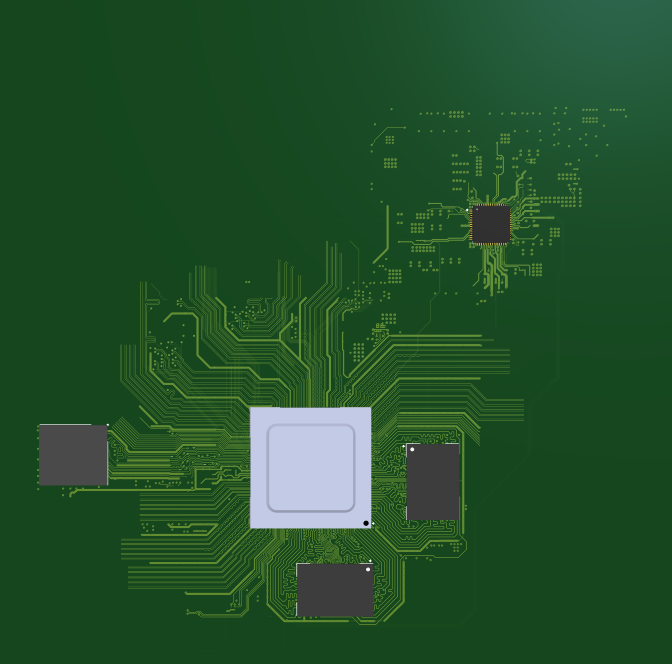

# Portfolio Projektowe / Engineering Portfolio
*Mateusz Kaczmarek - Hardware / PCB Engineer*

[🇬🇧 English version below](#english-version)

Witaj w moim repozytorium! Znajdziesz tutaj kompleksowe portfolio moich projektów inżynierskich i akademickich, obejmujących pełen cykl życia produktu – od koncepcji i schematów, przez symulacje, układanie obwodów drukowanych (PCB), integrację mechaniczną 3D, aż po finalny montaż i uruchomienie sprzętu (hardware bring-up).

Głównym obszarem moich zainteresowań i specjalizacji jest rygorystyczne projektowanie układów o mieszanym sygnale (Mixed-Signal), zaawansowanej energoelektroniki (Power Electronics) oraz systemów wbudowanych opartych na architekturze FPGA i układach SoC.

---

### 📸 Wybrane Projekty (Preview)

Poniżej znajduje się krótki zwiastun moich możliwości projektowych. **Z uwagi na ochronę własności intelektualnej (IP), pełna dokumentacja, schematy blokowe oraz pomiary laboratoryjne znajdują się wyłącznie w załączonym pliku PDF.**

**1. Uniwersalny Modułowy System Pomiarowy (High-Speed & SoC)**
Integracja układu Rockchip RK3588, FPGA Zynq-7100 oraz Switcha TSN (LAN9696) na 8-warstwowym obwodzie drukowanym.

> *Integracja ECAD-MCAD: Model 3D wierzchniej warstwy modułu obliczeniowego z widocznym układem BGA.*
> 

> *Signal Integrity: Meandrowanie i rygorystyczne wyrównywanie długości ścieżek (Length-Tuning) dla różnicowej magistrali PCIe.*
> 

**2. Zaawansowany System Audio-Wizualny (Mixed-Signal & HMI)**
Projekt łączący precyzyjne, niskoszumne tory audio z cyfrową jednostką sterującą STM32H7, układem zasilania Soft-Start na 4 transformatorach oraz zaawansowanym interfejsem graficznym.

> *Hardware Bring-up: Zmontowany i przetestowany fizyczny prototyp płyty głównej (Mixed-Signal).*
> 

> *Interfejs HMI: Działający panel operatorski z 7-calowym ekranem TFT (TouchGFX, 24-bit LTDC) oraz wdrożonymi bezstykowymi enkoderami magnetycznymi.*
> 

---

### 🛠️ Główne Kompetencje:
- **Projektowanie PCB (Altium, KiCad):** Obwody wielowarstwowe (High-Speed), kontrola impedancji, dopasowanie długości ścieżek (length tuning), Signal & Power Integrity (SI/PI).
- **Energoelektronika:** Projektowanie przetwornic, zasilacze izolowane LLC, topologie wielofazowe, filtry EMI.
- **Systemy Wbudowane:** STM32, FPGA (Xilinx Zynq, VHDL), systemy Linux Embedded (Rockchip).
- **Przetwarzanie Sygnałów (DSP):** Implementacja algorytmów (FFT, filtry cyfrowe), sprzętowa akwizycja danych.
- **Integracja MCAD-ECAD:** Mechaniczne modelowanie 3D (Autodesk Inventor, Fusion), projektowanie obudów i systemów chłodzenia, druk 3D.

### 📂 Pliki w Repozytorium:
- 📥 **[PORTFOLIO_KACZMAREK.pdf](./PORTFOLIO_KACZMAREK.pdf)** – Szczegółowy dokument z rzutami 3D, układem warstw PCB oraz zdjęciami zmontowanych układów.
- 📄 **[CV_Mateusz_Kaczmarek.pdf](./CV_Mateusz_Kaczmarek.pdf)** – Moje aktualne Curriculum Vitae.

Zapraszam do przeglądania i kontaktu!
- **LinkedIn:** [linkedin.com/in/mateusz-kaczmarek](https://www.linkedin.com/in/mateusz-kaczmarek-510382447)
- **Email:** [mateusz.kaczmarek000@o2.pl](mailto:mateusz.kaczmarek000@o2.pl)

---
 

# English Version

Welcome to my repository! Here you will find a comprehensive portfolio of my engineering and academic projects, covering the entire product life cycle - from concepts and schematics, through simulations, PCB layout, 3D mechanical integration, to final assembly and hardware bring-up.

My main areas of interest and expertise are rigorous Mixed-Signal circuit design, advanced Power Electronics, and embedded systems based on FPGA and SoC architectures.

---

### 📸 Selected Projects (Preview)

Below is a brief teaser of my design capabilities. **Due to Intellectual Property (IP) protection, full documentation, block diagrams, and laboratory measurements are available exclusively in the attached PDF file.**

**1. Universal Modular Measurement System (High-Speed & SoC)**
Integration of Rockchip RK3588, FPGA Zynq-7100, and a TSN Switch (LAN9696) on an 8-layer PCB.

> *ECAD-MCAD Integration: 3D model of the computing module's top layer featuring the BGA package.*
> 

> *Signal Integrity: Rigorous length tuning and meandering for a differential PCIe bus.*
> 

**2. Advanced Audio-Visual System (Mixed-Signal & HMI)**
A project combining precise, low-noise audio tracks with an STM32H7 digital control unit, a Soft-Start power supply system based on 4 transformers, and an advanced graphical interface.

> *Hardware Bring-up: Assembled and tested physical prototype of the main Mixed-Signal board.*
> 

> *HMI Interface: Functional operator panel with a 7-inch TFT screen (TouchGFX, 24-bit LTDC) and custom contactless magnetic encoders.*
> 

---

### 🛠️ Core Competencies:
- **PCB Design (Altium, KiCad):** Multilayer High-Speed circuits, impedance control, length tuning, Signal & Power Integrity (SI/PI).
- **Power Electronics:** Converters design, isolated LLC power supplies, multiphase topologies, EMI filters.
- **Embedded Systems:** STM32, FPGA (Xilinx Zynq, VHDL), Linux Embedded systems (Rockchip).
- **Digital Signal Processing (DSP):** Algorithm implementation (FFT, digital filters), hardware data acquisition.
- **MCAD-ECAD Integration:** 3D mechanical modeling (Autodesk Inventor, Fusion), enclosure and cooling system design, 3D printing.

### 📂 Files in this Repository:
- 📥 **[PORTFOLIO_KACZMAREK.pdf](./PORTFOLIO_KACZMAREK.pdf)** - Detailed document with 3D models, PCB layer stackups, and photos of assembled circuits.
- 📄 **[CV_Mateusz_Kaczmarek.pdf](./CV_Mateusz_Kaczmarek.pdf)** - My current Curriculum Vitae.

Feel free to explore and get in touch!
- **LinkedIn:** [linkedin.com/in/mateusz-kaczmarek](https://www.linkedin.com/in/mateusz-kaczmarek-510382447)
- **Email:** [mateusz.kaczmarek000@o2.pl](mailto:mateusz.kaczmarek000@o2.pl)
